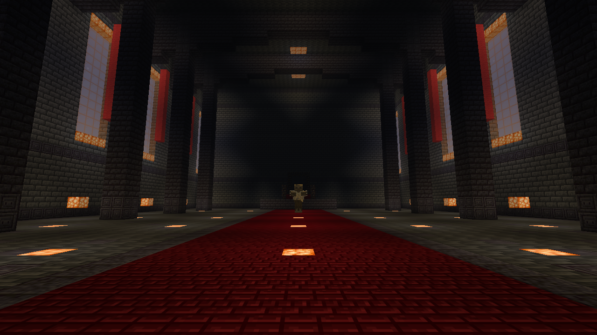
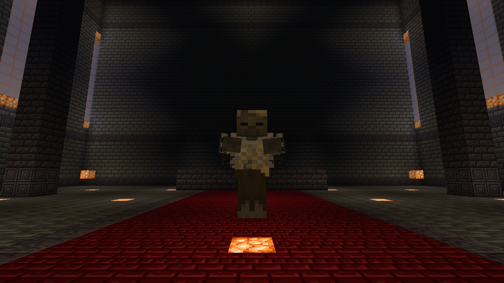
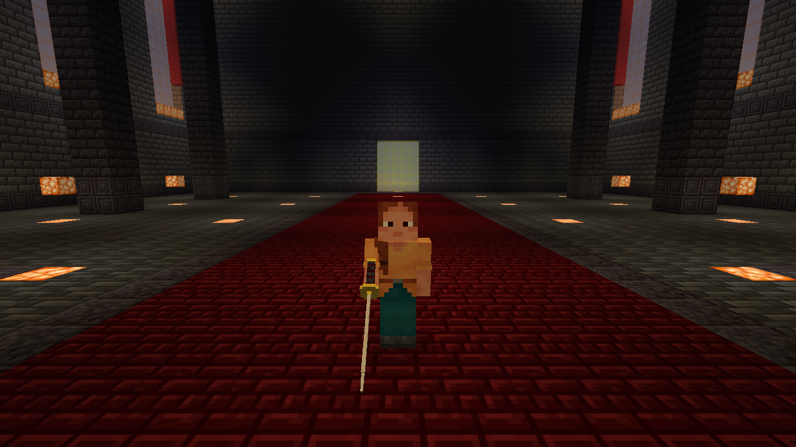

# Ashen Arena

A single-player Minecraft Java combat arena with directional dodges, a guarding katana, and an ogre boss that grabs and kicks.

**Early alpha: 1.0.0-alpha.1.** Requires Minecraft Java **26.3**, Fabric Loader **0.20.1 or newer**, Fabric API **0.166.0+26.3**, and Java **25 or newer**. Dedicated servers, multiplayer, and LAN play are unsupported.

Download the alpha from this repository's **Releases** tab. Use **Issues** to report bugs.

## Install

1. Back up any world you want to use. This alpha permanently adds blocks to the world.
2. Install [Fabric Loader](https://fabricmc.net/use/installer/) for Minecraft **26.3**.
3. Download [Fabric API](https://modrinth.com/mod/fabric-api) **0.166.0+26.3** and the Ashen Arena JAR from this repository's Releases page.
4. Put both JARs in your launcher's Minecraft `mods` folder. Remove older Ashen Arena JARs first so only one version is present.
5. Launch the Fabric profile and open a single-player world. Cheats are not required.

The release ZIP is an optional bundle of the same mod JAR, instructions, and license. Extract it first; put only the mod JAR in `mods`. Minecraft, Fabric Loader, and Fabric API are separate downloads.

## Enter the arena

Stand on solid ground in an open area and press **F8**. The entrance needs a clear space 7 blocks wide, 7 deep, and 8 high, seven blocks east of you. Wait for the hall-ready chat message, approach the golden glass, and press **E**. Inside, approach the entrance behind you and press **E** to return. E opens inventory normally elsewhere.

The ogre appears automatically. **Dodge the red grab cue late. Face the gold kick cue and guard, or dodge out of range.** Leave and re-enter after a victory for a fresh fight. Creative visitors see an idle boss; combat targets Survival and Adventure players.

| Control | Action |
| --- | --- |
| F8 | Place the world's entrance, or report its location |
| E near the gate | Enter or leave |
| Left Shift + movement | Dodge; without held movement, use the last movement key |
| Left Ctrl | Crouch; crouching prevents dodging |
| Right Ctrl | Sprint; double-tap forward also works |
| Left-click | Attack |
| Hold right-click with katana | Guard; release before dodging |
| F5 | Cycle Minecraft's first/third-person views |

Dodge can be rebound in Minecraft's key settings. The mod sets crouch and sprint defaults once, preserving a backup of options. Gate interaction keys E/F8 are fixed in this alpha. The quickstep has no invulnerability frames, stamina, or custom player animation.

## World behavior and limitations

- One entrance and one hall per world. The hall is built in batches in a secluded sky area of the Overworld around Y=256. First construction and chunk generation can cause pauses.
- The entire gate and hall region is protected against breaking, building, explosions, fire, fluids, and pistons, including in Creative.
- The boss and its bar clear when you die or leave. Arena chunks are not kept loaded.
- Removing the mod leaves the arena's blocks behind and removes its protection. Leave the hall and back up the world before uninstalling.
- Other mods, resource packs, shaders, custom dimensions, multiplayer, and dedicated servers have not been validated. Resource packs replacing the dragon track may change music loudness.

For bugs, include Minecraft/Fabric versions, steps to reproduce, other installed mods, and relevant log excerpts with personal details removed.

## Development, rights, and disclosure

The mod contains original code and model definitions that reference Minecraft resources. It does **not** bundle Minecraft music, textures, game code, Fabric API, or personal worlds. Music comes from the player's own Minecraft installation and is amplified during playback.

This branch contains the mod source and build files. All rights reserved; see [LICENSE](LICENSE). Source availability does not change the license.

## Build from source

On Windows, run Minecraft Java 26.3 once with the official launcher so its game JAR, libraries, and Java 25 runtime are installed under `%APPDATA%\.minecraft`. Place the build dependencies in `deps/`: Fabric Loader 0.20.1, Fabric API 0.166.0+26.3, and the Sponge Mixin and ASM JARs listed in the Fabric Loader 26.3 profile. Use the installed copies or download them from their official publishers. Dependencies are kept outside version control.

Run `./build.ps1` in PowerShell to compile the Java sources and package the resources into `dist/ashen-arena-1.0.0.jar`. The model generator is optional; its generated JSON is already included.

NOT AN OFFICIAL MINECRAFT PRODUCT. NOT APPROVED BY OR ASSOCIATED WITH MOJANG OR MICROSOFT. Minecraft belongs to its respective owners.
